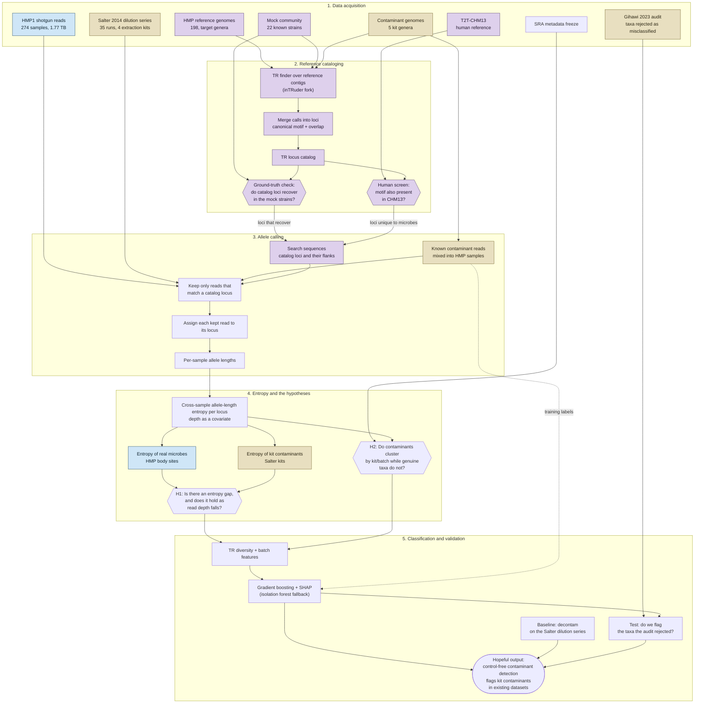

# What this project does

One picture of the whole project. The claim being tested is in `docs/problem.md`, the
step-by-step plan in `docs/todo.md`.

In one line: **genuine microbes are populations and kit contaminants are clones, so
tandem-repeat allele length should vary across samples for one and not the other** — and
that difference becomes a contaminant filter that needs no negative control.



A rendered copy of the same diagram is in `docs/flowchart.png`, for viewers that do
not draw Mermaid. Rebuild it after editing the block above:

```sh
docs/render-flowchart.sh docs/flowchart.md docs/flowchart.png 2
```

The script drives the local Chrome in headless mode: it renders the Mermaid block with
the ELK layout engine, lifts the lane titles clear of the edges, gives each edge a white
halo so crossings read as jumps, and screenshots the result at the trailing scale factor.
It needs Google Chrome installed and network access for the Mermaid module, so it is a
macOS helper rather than a Pixi task. GitHub draws the block above with its own layout
engine, so the page and the PNG route their edges differently.

## How to read it

- **Three colours, three roles.** Blue is the genuine side (HMP, real people, real
  diversity). Tan is the contaminant side (Salter's kits, the clonal spike-ins, the known
  false positives). Purple is reference material — the genomes that say *where* to look,
  and the screens that decide which loci are trustworthy.
- **The two hexagons in lane 2 are checks, not steps.** Everything downstream is
  conditional on them: a locus that does not recover in genomes of known strains is a
  finder artifact, and a motif that also occurs in human cannot separate contamination
  from host — that is the same confusion one level down.
- **Lane 3 never lands the data.** The HMP samples are ~6.5 TB decompressed, so each is
  read, unpacked and filtered in a single pass on the cluster, and only locus-hitting
  reads are kept.
- **Lane 4 is the experiment.** Lanes 1–3 are machinery whose only purpose is to produce
  a defensible number for the entropy of one locus in one sample.

## State of play

Lanes 1–3 are partly built: data acquisition and the streaming read filter exist, the TR
finder runs over reference genomes, and the mock-community catalog has been built once.
The locus merge, the human screen, allele calling, the stutter model, entropy, both
hypothesis tests and the classifier do not exist yet — `--stage pipeline` stops after the
read filter. `docs/todo.md` tracks each box.
